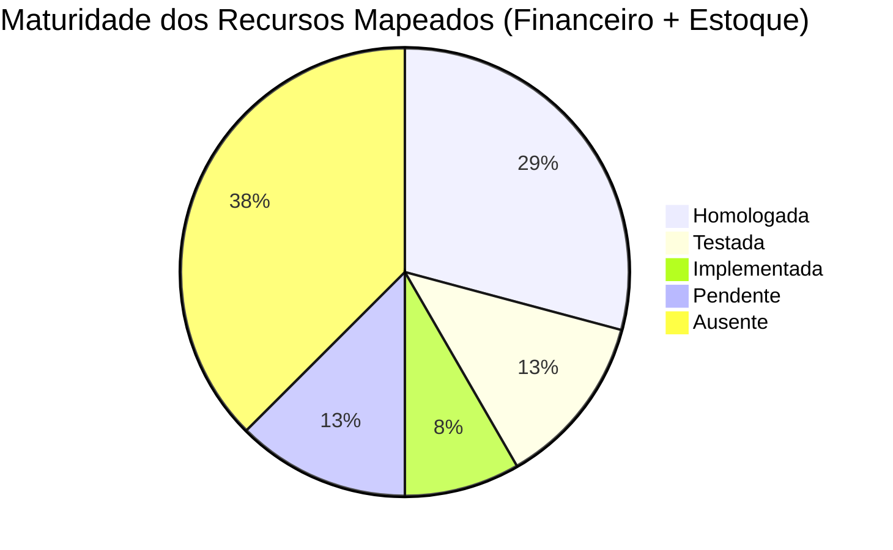
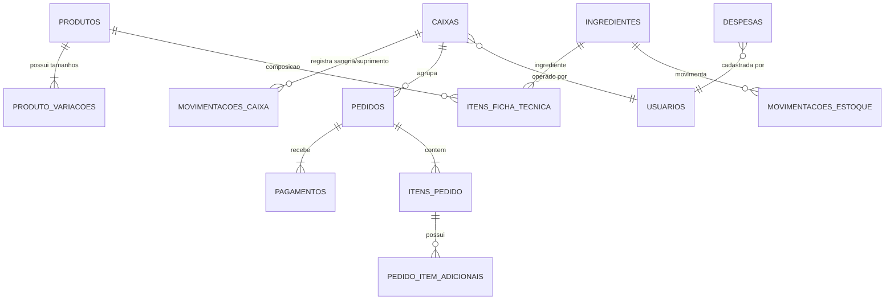
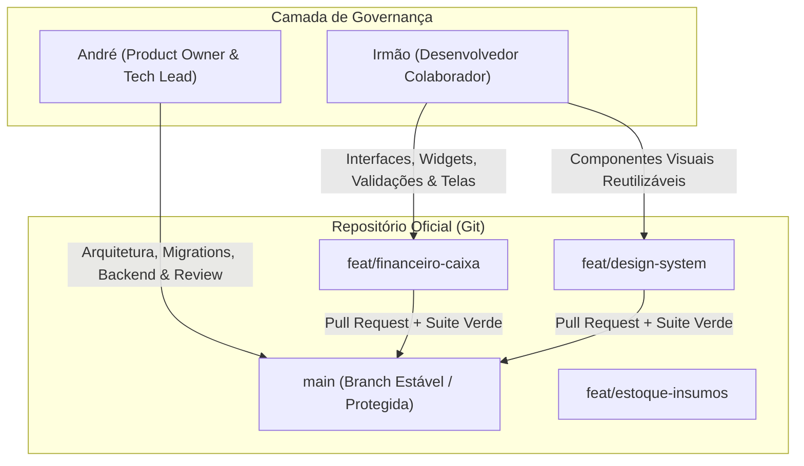

# QUENTINHAS PRO — PLANO DE EVOLUÇÃO ESTRUTURAL
**MISSÃO:** `QP-EVOLUCAO-001`  
**DATA:** 15/10/2026  
**STATUS:** 🟢 **PLANEJAMENTO CONCLUÍDO**  
**ARQUITETURA OFICIAL:** Flutter Web + Spring Boot 4.1.0 + PostgreSQL 16 (Docker)

---

## 1. VISÃO GERAL & PRINCÍPIOS DA EVOLUÇÃO

O **Quentinhas Pro** consolidou com sucesso suas fundações críticas de autenticação (QP-AUTH-001/002), fluxo de vendas e catálogo com adicionais (QP-COMERCIAL-003) e máquina de transições operacionais com integridade de baixa de estoque e vínculo de caixa (QP-COMERCIAL-004).

O objetivo desta missão é estabelecer o **planejamento estrutural** para transformar essas funcionalidades em um sistema de gestão integrado e comercialmente robusto, sustentando:
1. **Controle Financeiro Confiável**: separação matemática entre faturamento bruto, recebimentos por meio e saldo físico de dinheiro na gaveta.
2. **Estoque de Operação Real**: transição de um simples contador de quentinhas para o controle rastreável de insumos, ficha técnica por tamanho e perdas.
3. **Interface Visual Profissional**: design system consistente (fundo neutro `#F4F6F8`, cartões brancos com bordas suaves, tipografia estruturada e laranja institucional `#FF5A1F` para ações e destaques), alinhado às referências visuais da gestão.
4. **Governança de Colaboração**: estrutura de módulos e contratos que permite a atuação simultânea de dois desenvolvedores (André e seu irmão) sem regressões, retrabalho ou arquiteturas paralelas.

---

## 2. DIAGNÓSTICO & MAPEAMENTO DE CAPACIDADES

> **Convenção Obrigatória de Classificação**:
> - **HOMOLOGADA**: Validada com evidência real na interface de usuário e persistência auditada no PostgreSQL.
> - **TESTADA**: Coberta por suíte automatizada de testes no backend ou frontend, mas sem homologação ponta a ponta na UI.
> - **IMPLEMENTADA**: Código existente (model, controller ou tela), porém com lacunas ou sem cobertura formal de testes.
> - **PENDENTE**: Funcionalidade com modelagem parcial ou dependência aberta no domínio.
> - **AUSENTE**: Não existe no banco de dados, no backend nem no frontend.



---

### A. FINANCEIRO & CAIXA

| Capacidade | Status | Evidência Técnica no Repositório | Lacuna ou Defeito Comprovado |
|---|---|---|---|
| **Registro de Vendas por Pagamento** | 🟢 **HOMOLOGADA** | Tabela `pagamentos` vinculada ao pedido. Homologado com Dinheiro e Troco na QP-003/004. | Nenhuma no fluxo de venda à vista. |
| **Cálculo de Troco Automático** | 🟢 **HOMOLOGADA** | Backend calcula `valorRecebido - total`. Frontend exibe campo condicional para Dinheiro. | Nenhuma. |
| **Consulta de Caixa Ativo** | 🟢 **HOMOLOGADA** | `GET /api/caixas/ativo` busca `PDV-01` aberto. Utilizado na validação do PDV e Checkout. | Nenhuma. |
| **Abertura de Caixa com Saldo Inicial** | 🟡 **TESTADA** | `POST /api/caixas/abrir` validado em `CaixaIntegrationTest`. Índice único no banco. | Na UI (`tela_caixa.dart`), o saldo inicial é fixado em `0.0` sem input para o operador. |
| **Bloqueio de Múltiplos Caixas no Terminal** | 🟢 **HOMOLOGADA** | `CaixaController` retorna `409 Conflict`. Validado no teste de ciclo operacional. | Nenhuma. |
| **Fechamento de Caixa com Apuração de Saldo** | 🟡 **TESTADA** | `POST /api/caixas/fechar` grava `fechado_em` e `saldo_informado`. | **DEFEITO ARQUITETURAL GRAVE:** soma PIX e Cartão ao `saldoInicial` da gaveta como se fossem dinheiro físico. |
| **Separação por Forma de Pagamento no Caixa** | 🟠 **PENDENTE** | Tabela `pagamentos` registra a forma, mas o fechamento ignora a segregação. | Não gera o resumo consolidado: Dinheiro vs PIX vs Cartão Débito vs Cartão Crédito. |
| **Sangrias e Suprimentos de Caixa** | 🔴 **AUSENTE** | Nenhuma tabela de movimentações de caixa. | Operador não pode registrar retirada de dinheiro para cofre nem entrada de troco com justificativa. |
| **Entradas e Saídas Avulsas Auditáveis** | 🔴 **AUSENTE** | Sem tabelas nem endpoints para lançamentos manuais de caixa. | Falta rastreabilidade de operador, motivo e data/hora. |
| **Contas a Pagar e Despesas Operacionais** | 🔴 **AUSENTE** | Não existem tabelas de despesas, fornecedores ou categorias de custo. | Impossível apurar resultado operacional líquido real (DRE operacional). |
| **Histórico de Caixas Fechados** | 🔴 **AUSENTE** | Backend só expõe `/api/caixas/ativo`. Não há endpoint para listar caixas anteriores. | Impossível auditar turnos anteriores ou reimprimir fechamentos antigos. |
| **Estornos e Cancelamentos Financeiros** | 🟠 **PENDENTE** | Check constraints prevêem `ESTORNADO`, mas não há rotina de estorno associada ao caixa. | Ao cancelar pedido, não há devolução explícita no saldo do caixa. |

---

### B. ESTOQUE & OPERAÇÃO DA COZINHA

| Capacidade | Status | Evidência Técnica no Repositório | Lacuna ou Defeito Comprovado |
|---|---|---|---|
| **Produtos Comerciais e Categorias** | 🟢 **HOMOLOGADA** | Tabela `produtos`, `ProdutoRepository`, `GET /api/catalogo`. | Nenhuma. |
| **Variações de Tamanho (P, M, G)** | 🟢 **HOMOLOGADA** | Tabela `produto_variacoes`, preços independentes por tamanho. | Nenhuma. |
| **Adicionais e Complementos** | 🟢 **HOMOLOGADA** | Tabelas `adicionais` e `pedido_item_adicionais`. | Nenhuma. |
| **Baixa Atômica de Estoque na Venda** | 🟢 **HOMOLOGADA** | `PedidoService` executa `SELECT FOR UPDATE` e baixa `estoque_atual`. | O desconto ocorre na tabela `produtos` (produto final), não nos insumos. |
| **Bloqueio de Venda sem Estoque** | 🟢 **HOMOLOGADA** | Retorna `409 Conflict` (`StockEsgotadoException`). Testado e homologado. | Nenhuma. |
| **Garantia contra Baixa Duplicada** | 🟢 **HOMOLOGADA** | Transições de status não tocam na tabela de produtos. Auditado na QP-004. | Nenhuma. |
| **Insumos e Matérias-Primas (kg, g, un)** | 🔴 **AUSENTE** | Tabela `ingredientes` existe na migration `V1`, mas **sem JPA, Service, Controller ou UI**. | Operação não enxerga arroz, feijão, carnes, óleo e embalagens. |
| **Fichas Técnicas por Tamanho** | 🔴 **AUSENTE** | Tabelas `itens_ficha_tecnica` e `regras_porcionamento` na `V1`, mas **inativas no código**. | Não há consumo proporcional (ex: P consome 150g, G consome 300g). |
| **Movimentações Auditáveis de Estoque** | 🔴 **AUSENTE** | Tabela `movimentacoes_estoque` existe no banco, mas **sem endpoints**. | `PUT /api/gestao/estoque/{id}` sobrescreve o saldo sem registrar compra, perda ou inventário. |
| **Disponibilidade Dinâmica Compartilhada** | 🟠 **PENDENTE** | Atualmente todos os tamanhos compartilham um único número inteiro `produto.estoque_atual`. | Se o produto-base esgotar, os tamanhos são bloqueados, mas sem vínculo com a capacidade de produção. |

---

### C. INTERFACE VISUAL & DESIGN SYSTEM

| Tela | Situação Atual | Inconsistência Encontrada | Ação Recomendada |
|---|---|---|---|
| **Shell Principal** | Menu lateral laranja `#FF5A1F` com navegação para 12 opções. | Ícones e títulos corretos, mas opções 7 e 11 exibem apenas "Em Breve". | Manter estrutura; integrar as novas telas à medida que forem homologadas. |
| **PDV / Cardápio** | Grid de cards com tamanhos P/M/G e carrinho lateral retrátil. | Funcional, mas botões de tamanho poderiam ter melhor affordance de seleção. | Refinar espaçamentos, tipografia dos cards e feedback tátil. |
| **Checkout** | Formulário 2 colunas com validações semânticas e totais claros. | Estilo já aderente ao AppTheme. | Padronizar inputs de valor e diálogo de sucesso. |
| **Cozinha / KDS** | Colunas tipo Kanban (Novos / Em Produção / Prontos). | Funcional, mas falta contador de tempo decorrido por pedido e alerta de atraso. | Aplicar cards brancos limpos com badges de tempo e som/alerta de novo pedido. |
| **Pedidos** | Tabela em `tela_lista_pedidos.dart` com filtros e ações de status. | Tabela não possui paginação no backend e usa botões inline desalinhados. | Adotar `AppDataTable` com cabeçalho fixo, pesquisa e paginação. |
| **Frente de Caixa** | `tela_caixa.dart` exibe um único card simples com "ABERTO/FECHADO". | **Totalmente insuficiente:** não exibe resumo financeiro do turno, vendas por meio nem sangria. | **Reconstruir a tela** com layout de frente de caixa profissional (conforme referências visuais). |
| **Dashboard** | `tela_dashboard_real.dart` com cards de métricas e gráficos. | Cores divergentes do AppTheme (`Colors.blue`, `Colors.amber`); calcula tudo no front. | Migrar indicadores para endpoint consolidado e aplicar cards padrão. |
| **Relatórios** | `TelaRelatoriosFinanceiros` dentro do arquivo monolítico `main.dart`. | Utiliza componentes antigos misturados com o código legado. | Extrair de `main.dart` para `lib/screens/financeiro/` com visual moderno. |

---

## 3. ARQUITETURA DE DADOS: O NOVO MODELO FINANCEIRO E DE ESTOQUE

Para sanar as lacunas identificadas sem quebrar as tabelas já em produção, desenhamos a modelagem relacional que complementa o banco:



### A Fórmula Matemática da Conciliação de Caixa

No fechamento de caixa, o sistema deve calcular separadamente:

$$\text{Dinheiro Esperado na Gaveta} = \text{Saldo Inicial} + \sum \text{Vendas em Dinheiro (Líquidas)} + \sum \text{Suprimentos} - \sum \text{Sangrias}$$

$$\text{Diferença de Caixa (Gaveta)} = \text{Dinheiro Físico Contado} - \text{Dinheiro Esperado na Gaveta}$$

$$\text{Faturamento Total do Turno} = \sum \text{Vendas Dinheiro} + \sum \text{Vendas PIX} + \sum \text{Vendas Cartão}$$

> **Atenção:** PIX e Cartões entram na conta bancária / adquirente, **NUNCA** no dinheiro da gaveta. O sistema anterior misturava esses conceitos; o novo modelo isola cada meio de pagamento.

---

## 4. ESTRUTURAÇÃO DE EQUIPE & GOVERNANÇA DE CÓDIGO

Para que **André** (Product Owner & Fullstack Lead) e seu **irmão** (Desenvolvedor Colaborador) trabalhem em paralelo com produtividade máxima e risco zero de conflito:



### Matriz de Responsabilidades (RACI)

| Atividade | André | Irmão | Critério de Homologação |
|---|---|---|---|
| **Definição de Regras Comerciais** | **R**esponsável | **C**onsultado | Validação com a operação real |
| **Migrations do Banco de Dados** | **R**esponsável | **I**nformado | Flyway migrations versionadas sem drops |
| **Endpoints Backend (Spring Boot)** | **R**esponsável | **C**olaborador | Testes de integração JUnit passing |
| **Componentes de Design System (Flutter)** | **A**provador | **R**esponsável | Widgets reutilizáveis em `lib/widgets/common/` |
| **Telas de Gestão e Formulários (Flutter)** | **A**provador | **R**esponsável | `flutter analyze` 0 warnings + `flutter test` pass |
| **Testes de Regressão & Aceite Final** | **R**esponsável | **C**olaborador | Execução no Chrome real com prints e SQL |

### Regras Operacionais de Trabalho
1. **Fim do Arquivo Monolítico:** Nenhuma alteração nova deve ser escrita dentro de `lib/main.dart`. Novas telas devem ser criadas em pastas modulares dedicadas:
   - `lib/screens/financeiro/`
   - `lib/screens/estoque/`
   - `lib/widgets/common/`
2. **Contratos de API First:** Antes de codificar uma tela, o DTO (JSON Request/Response) é formalizado e aprovado.
3. **Barreira de Qualidade Local:** Nenhum merge na `main` sem a execução obrigatória:
   ```powershell
   flutter analyze
   flutter test
   .\mvnw test
   ```

---

## 5. PLANO DE IMPLEMENTAÇÃO — 10 ITENS PRIORITÁRIOS

Abaixo está o backlog estrutural detalhado, ordenado por **Impacto no Negócio**, **Risco Técnico**, **Dependências** e **Esforço**:

```mermaid
gantt
    title Cronograma de Implementação dos 10 Itens Prioritários
    dateFormat  X
    axisFormat %d
    
    section Fase 2 - Financeiro
    Item 1 (Conciliação Caixa)       :active, 1, 3
    Item 2 (Sangria e Suprimento)    : 3, 5
    Item 3 (Tela Frente de Caixa)    : 4, 7
    Item 4 (Histórico e Relatórios)  : 6, 8
    Item 5 (Gestão de Despesas)      : 7, 10
    
    section Fase 3 - Estoque
    Item 6 (Movimentações Estoque)   : 8, 11
    Item 7 (Insumos e Ficha Técnica) : 10, 13
    Item 8 (Disponibilidade Tamanho): 12, 14
    
    section Fase 4 - Visual
    Item 9 (Design System Padrão)    : 2, 6
    Item 10 (Refatoração Monólito)   : 11, 15
```



---

### ITEM 1 — Correção da Conciliação de Caixa por Meio de Pagamento
* **Problema Comprovado:** `CaixaController.fecharCaixa` soma o faturamento total (incluindo PIX e Cartão) ao `saldoInicial` da gaveta física, gerando falsas diferenças absurdas entre valor contado e valor esperado.
* **Comportamento Desejado:** O backend deve segregar na resposta do fechamento:
  - Total recebido em Dinheiro
  - Total recebido em PIX
  - Total recebido em Cartão
  - Saldo físico esperado da gaveta = `saldoInicial + totalDinheiro + suprimentos - sangrias`.
* **Módulos Afetados:** `backend/controller/CaixaController.java`, `dto/response/CaixaFechamentoResponse.java`.
* **Testes Necessários:** `CaixaIntegrationTest` simulando pedidos com Dinheiro, PIX e Cartão e validando a matemática de fechamento.
* **Critério de Aceite:** `diferenca` calculada exclusivamente sobre o valor em espécie da gaveta.

---

### ITEM 2 — Sangria e Suprimento de Caixa Auditáveis
* **Problema Comprovado:** Não existe forma de retirar dinheiro do caixa (sangria para cofre) nem de reforçar troco (suprimento) durante o expediente sem corromper a contabilidade.
* **Comportamento Desejado:** Nova tabela `movimentacoes_caixa` com `tipo` ('SANGRIA', 'SUPRIMENTO'), `valor`, `motivo`, `operador_id` e endpoints `POST /api/caixas/{id}/sangria` e `POST /api/caixas/{id}/suprimento`.
* **Módulos Afetados:** Migration SQL Flyway, `model/MovimentacaoCaixa.java`, `controller/CaixaController.java`.
* **Testes Necessários:** Teste de sangria maior que saldo em dinheiro (bloqueio), teste de incremento do saldo esperado após suprimento.
* **Critério de Aceite:** Toda sangria/suprimento persiste no banco e afeta imediatamente o saldo da gaveta.

---

### ITEM 3 — Interface Profissional de Frente de Caixa (Flutter)
* **Problema Comprovado:** `tela_caixa.dart` atual é uma tela vazia com apenas um ícone e botão de abrir/fechar com `0.0` fixado no código.
* **Comportamento Desejado:** Tela moderna baseada nas referências visuais:
  - Diálogo de abertura solicitando digitação do fundo de troco inicial.
  - Painel com resumo em tempo real do turno: Saldo Inicial, Total em Dinheiro, Total em PIX, Total em Cartão.
  - Botões dedicados para Sangria e Suprimento com formulário e motivo.
  - Fechamento com digitação do valor contado e exibição clara de sobras/faltas antes da confirmação.
* **Módulos Afetados:** `lib/screens/gestao/tela_caixa.dart`, `lib/services/pedido_service.dart`.
* **Testes Necessários:** Widget test de validação dos inputs de abertura, sangria e fechamento.
* **Critério de Aceite:** Operador abre, visualiza parciais por forma de pagamento e fecha informando os valores contados reais.

---

### ITEM 4 — Histórico de Caixas Anteriores e Relatório de Fechamento
* **Problema Comprovado:** Não existe visualização de caixas fechados no passado. Ao fechar um caixa, a informação some da tela e não pode ser reexaminada.
* **Comportamento Desejado:** Endpoint `GET /api/caixas/historico` com paginação e filtro por data, e tela no Flutter permitindo consultar fechamentos passados, detalhes de sangrias e faturamento total.
* **Módulos Afetados:** `CaixaController.java`, `lib/screens/financeiro/tela_historico_caixas.dart`.
* **Testes Necessários:** Consulta paginada no backend e renderização de lista histórica no front.
* **Critério de Aceite:** O gerente visualiza a lista dos últimos caixas fechados com suas respectivas apurações e diferenças.

---

### ITEM 5 — Gestão Básica de Despesas Operacionais (Contas a Pagar)
* **Problema Comprovado:** O sistema só enxerga faturamento bruto de vendas, impossibilitando apurar o lucro real do dia ou do mês.
* **Comportamento Desejado:** Nova tabela `despesas` (`descricao`, `categoria`, `valor`, `data_vencimento`, `data_pagamento`, `status`, `forma_pagamento`) e CRUD correspondente no backend e no front.
* **Módulos Afetados:** Migration SQL Flyway, `backend/model/Despesa.java`, tela de despesas no Flutter.
* **Testes Necessários:** Testes de validação de valores positivos e filtros por período.
* **Critério de Aceite:** Cadastro de despesas operacionais (gás, energia, motoboy, compras) com impacto no resultado operacional.

---

### ITEM 6 — Movimentações de Estoque Rastreáveis (Entrada, Perda e Ajuste)
* **Problema Comprovado:** `PUT /api/gestao/estoque/{id}` sobrescreve o saldo do produto diretamente sem gravar motivo, operador ou histórico.
* **Comportamento Desejado:** Ativar o uso de `movimentacoes_estoque` registrando:
  - Entradas por compra de produtos/bebidas
  - Ajustes de inventário com justificativa
  - Perdas/descartes de produção
* **Módulos Afetados:** `controller/EstoqueController.java`, `service/EstoqueService.java`.
* **Testes Necessários:** Teste de auditoria garantindo que todo ajuste de saldo gera uma linha em `movimentacoes_estoque`.
* **Critério de Aceite:** O histórico de estoque exibe quando, quanto e por que o saldo mudou.

---

### ITEM 7 — Mapeamento de Insumos e Ficha Técnica por Tamanho
* **Problema Comprovado:** A operação só controla produtos finais (quentinhas montadas), mas a cozinha precisa comprar e gerenciar ingredientes (kg de frango, sacos de arroz, óleo, caixas de quentinhas).
* **Comportamento Desejado:** Ativar no backend as tabelas `ingredientes` e `itens_ficha_tecnica`:
  - Cadastro de ingredientes com unidade de medida (`KG`, `G`, `L`, `UN`).
  - Associação de insumos aos pratos com porcionamento específico para P, M e G.
* **Módulos Afetados:** `backend/model/Ingrediente.java`, `ItemFichaTecnica.java`, tela de cadastro técnico.
* **Testes Necessários:** Cálculo de consumo estimado de insumos com base nos pedidos realizados.
* **Critério de Aceite:** Ficha técnica cadastrada permitindo calcular o consumo teórico da produção do dia.

---

### ITEM 8 — Recálculo Automático de Disponibilidade Comercial Compartilhada
* **Problema Comprovado:** Se o estoque de um prato acaba, o sistema bloqueia apenas pelo campo `produto.estoque_atual`, mas quando múltiplos tamanhos dependem de um insumo crítico (ex: carne bovina), o esgotamento não é propagado de forma inteligente.
* **Comportamento Desejado:** Algoritmo no backend que avalia a disponibilidade do produto-base e atualiza atômica e simultaneamente o status de venda de todas as suas variações (P, M, G).
* **Módulos Afetados:** `service/PedidoService.java`, `controller/CatalogoController.java`.
* **Testes Necessários:** Teste concorrente de esgotamento onde o consumo da última unidade P desativa imediatamente M e G.
* **Critério de Aceite:** Nenhuma venda é permitida em nenhum tamanho após o esgotamento do recurso compartilhado.

---

### ITEM 9 — Design System & Biblioteca de Componentes Visuais (Flutter)
* **Problema Comprovado:** Elementos visuais (cards de métricas, tabelas, modais, badges de status) são repetidos em código duplicado com variações de padding, fontes e cores em várias telas.
* **Comportamento Desejado:** Criar pasta `lib/widgets/common/` com componentes padrão reutilizáveis:
  - `MetricCard`: card de KPI com valor grande, label suave e ícone.
  - `AppDataTable`: tabela uniforme com cabeçalho limpo, zebra striping e paginação.
  - `StatusBadge`: pílula semântica (Verde, Âmbar, Azul, Vermelho).
  - `MoneyInputField`: input com máscara monetária formatada em R$.
* **Módulos Afetados:** `lib/widgets/common/`, `lib/theme/app_theme.dart`.
* **Testes Necessários:** Widget tests para formatação monetária e renderização visual dos componentes.
* **Critério de Aceite:** Pelo menos 3 telas existentes consumindo os componentes padronizados sem divergências visuais.

---

### ITEM 10 — Modularização e Decomposição do Monólito `main.dart`
* **Problema Comprovado:** `lib/main.dart` possui **2.587 linhas de código**, acumulando telas inteiras (`TelaGestaoProdutos`, `TelaControleEstoqueRapido`, `TelaRelatoriosFinanceiros`, `TelaGestaoEquipe`), o que inviabiliza o trabalho concorrente de dois desenvolvedores sem conflitos de merge (git conflicts).
* **Comportamento Desejado:** Extrair cada tela e componente para seu respectivo arquivo sob `lib/screens/`, deixando em `main.dart` apenas a inicialização do app, injeção de dependências e roteamento raiz.
* **Módulos Afetados:** `lib/main.dart`, novos arquivos em `lib/screens/produtos/`, `lib/screens/estoque/`, `lib/screens/equipe/`.
* **Testes Necessários:** `flutter analyze` e `flutter test` após cada extração, assegurando 0 regressões.
* **Critério de Aceite:** `main.dart` com menos de 200 linhas de código e todas as telas isoladas em seus próprios módulos.

---

## 6. PRÓXIMO PASSO RECOMENDADO

Com este diagnóstico e planejamento técnico formalizados, a recomendação para a retomada do projeto é executar o **ITEM 1** e o **ITEM 3** em conjunto:

> **Missão de Retomada:** `QP-FINANCEIRO-001`  
> **Objetivo:** Implementar a conciliação real do caixa segregando dinheiro físico (gaveta), PIX e cartão no backend, e entregar a nova interface de Frente de Caixa no Flutter com inputs de saldo inicial, exibição dos totais do turno e fechamento auditável.
